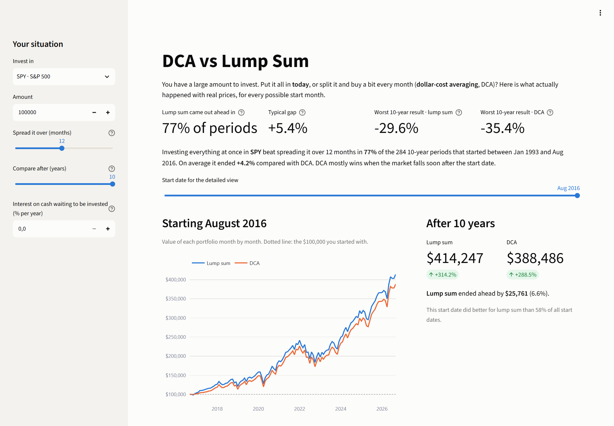

# DCA vs Lump Sum

**Got a large amount to invest: put it all in today, or spread it over the next few months?** This tool answers it with real ETF prices, for every month you could have started since 1993.



[](https://github.com/lucas-santos-f/dca-vs-lump-sum/actions/workflows/tests.yml)


## The answer, with real numbers

Investing $100,000 in SPY (S&P 500, dividends reinvested), either all at once or in 12 equal monthly parts, and comparing the two after 10 years:

- **Lump sum came out ahead in 77% of the 284 ten-year periods** that started between January 1993 and August 2016.
- On average it ended **4.2% ahead** of spreading the money over a year (median 5.4%).
- DCA wins when the market falls soon after the start. Its best case was starting in May 2008, right before the financial crisis: DCA ended **28.5% ahead**. The mirror case, starting in February 2009 at the bottom, left DCA **30.8% behind**.
- Spreading over 24 months instead of 12 makes things worse on average: lump sum wins 80% of the time and by 9.2%.
- Earning 4% a year on the cash waiting to be invested narrows the gap but doesn't close it: lump sum still wins 70% of the time, by 2.4% on average.

The same pattern holds for every fund in the dataset (12-month DCA, 10-year horizon):

| Fund | What it holds | Periods | Lump sum won | Average gap |
|---|---|---:|---:|---:|
| SPY | S&P 500 | 284 | 77% | +4.2% |
| QQQ | Nasdaq-100 | 210 | 70% | +2.9% |
| VTI | US total stock market | 183 | 75% | +3.5% |
| VEA | Developed markets ex-US | 110 | 55% | +0.5% |
| AGG | US aggregate bonds | 156 | 85% | +1.9% |
| GLD | Gold | 142 | 63% | +4.1% |

The reason is simple: markets rose in most months, so money kept on the sidelines usually misses gains. DCA is insurance against bad timing, and like any insurance it costs something in the typical case. What it buys is a smaller worst case over short horizons: over one year, SPY's worst lump-sum result was -43.4% (starting February 2008) against -33.9% for DCA.

## What it does

- **Headline numbers:** how often lump sum won, the typical gap, and each strategy's worst result over the chosen horizon.
- **One start date in detail:** the month-by-month value of both portfolios, including how much DCA still holds in cash.
- **Distribution:** a histogram of the result across every start month, split into "lump sum ahead" and "DCA ahead".
- **Result by start date:** shows *when* DCA wins (2000-2002, 2007-2008) and when it loses.
- Inputs: fund, amount, DCA length (1-24 months), horizon (1-10 years) and the interest earned by cash waiting to be invested.

## Quick start

```bash
git clone https://github.com/lucas-santos-f/dca-vs-lump-sum.git
cd dca-vs-lump-sum
pip install -r requirements.txt
streamlit run app.py
```

The repository ships with a price snapshot, so it runs offline with no API keys or configuration.

## Method

Prices are month-end closes. Money is invested at the close of a month, and month 0 is the start date.

- **Lump sum** buys with the whole amount at month 0.
- **DCA** buys in N tranches at months 0 to N-1. Money waiting to be invested earns the chosen annual rate, compounded monthly. Each tranche invests an equal share of the cash still waiting (`balance / tranches left`), so the interest is invested too and DCA is fully invested after the last tranche. At 0% every tranche is exactly `amount / N`.
- Both portfolios are valued at month H, the horizon (H >= N).
- The **rolling-window analysis** repeats this for every start month that has H months of history after it. The gap for one window is `lump_sum / dca - 1`: +5% means lump sum ended with 5% more money than DCA. A gap below one billionth of a percent is a tie, not a win.

Taxes, trading costs and bid-ask spreads are ignored; they would slightly favor lump sum, which trades once.

## Data

Monthly prices for SPY, QQQ, VTI, VEA, AGG and GLD from the start of each fund (SPY: January 1993) through August 2026, in [`data/monthly_prices.csv`](data/monthly_prices.csv).

The source is Yahoo Finance via [yfinance](https://github.com/ranaroussi/yfinance), with prices adjusted for splits **and dividends**, so every return in the app is a total return with dividends reinvested. Daily closes are resampled to the last close of each month, and the month still in progress is dropped.

To refresh the snapshot:

```bash
python scripts/update_prices.py            # every fund
python scripts/update_prices.py SPY GLD    # some funds
```

If Yahoo Finance fails for a fund, the script falls back to [Stooq](https://stooq.com). Stooq prices are adjusted for splits but **not for dividends**, so they understate total return by roughly the fund's dividend yield (about 1-2% a year for SPY); the script prints a warning when it uses them. Stooq sometimes asks browsers to pass a check before serving files. In that case, download the daily CSV in your browser and import it:

```bash
python scripts/update_prices.py --file SPY path/to/spy_us_d.csv
```

## Project structure

```
app.py                     Streamlit dashboard
dca_vs_lump/
  prices.py                download, resample, read/write the price snapshot
  strategies.py            lump sum vs DCA simulation and rolling-window summary
scripts/update_prices.py   refresh the snapshot
data/                      monthly price snapshot
tests/                     unit tests on small hand-built price paths
```

## Development

```bash
pip install -r requirements-dev.txt
pre-commit install
```

Every commit and every push runs the same checks:

| Check | Tool | Rule |
|---|---|---|
| Lint | ruff | pycodestyle, pyflakes, isort, bugbear, pyupgrade and more |
| Format | ruff format | no diff allowed |
| Types | mypy | `--strict` on the `dca_vs_lump` package |
| Tests | pytest + pytest-cov | fails below 85% coverage |

The tests use price paths short enough to check by hand: a steady rise where lump sum must win, an early crash where DCA must win, cash interest, and the edge cases of the rolling windows.

## Roadmap

- [ ] Inflation-adjusted results
- [ ] Custom tickers fetched on demand
- [ ] "Invest on dips" rules as a third strategy
- [ ] Hosted demo

## Disclaimer

For education and analysis only. This is not investment advice. Past returns don't predict future ones.

## License

[MIT](LICENSE)
